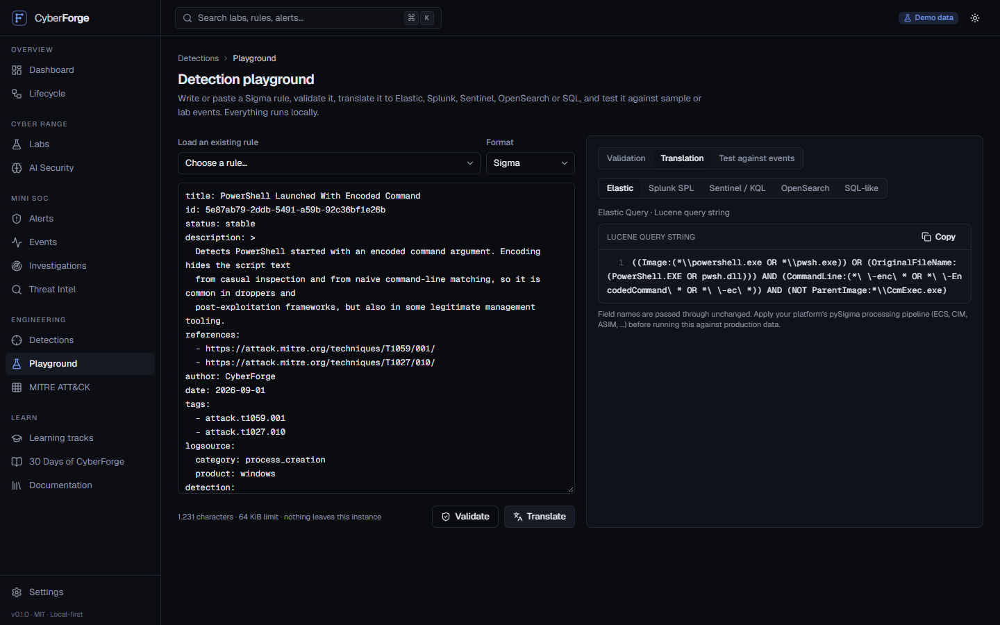
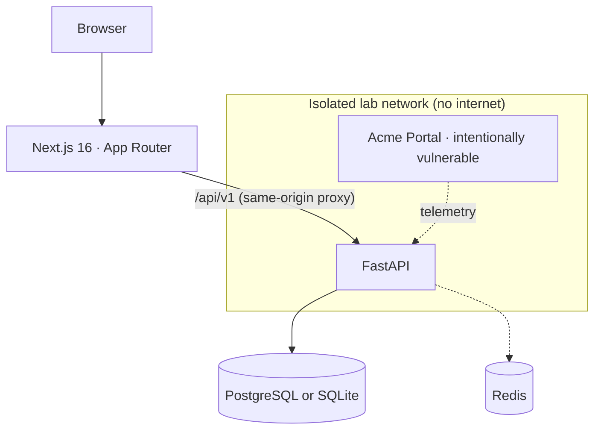

<div align="center">


# CyberForge

**An open, local-first cybersecurity lab for detection engineering.**

Replay an incident. Explain the detection. Investigate the alert.

[](https://github.com/rahmankutlu/cyberforge/actions/workflows/ci.yml)
[](https://github.com/rahmankutlu/cyberforge/actions/workflows/e2e.yml)
[](https://github.com/rahmankutlu/cyberforge/actions/workflows/codeql.yml)
[](https://github.com/rahmankutlu/cyberforge/actions/workflows/security.yml)
[](https://github.com/rahmankutlu/cyberforge/releases/latest)
[](LICENSE)

[Quick start](#quick-start) · [First investigation](#try-your-first-investigation) · [Features](#features) · [Architecture](#architecture) · [Documentation](#documentation) · [Contributing](#contributing)

</div>

---

CyberForge is for **blue teams, SOC analysts and detection engineers** who want to learn by doing. It combines a cyber range, a mini SOC, a detection playground for Sigma, YARA and Suricata, and an MITRE ATT&CK explorer. The lab runs locally with synthetic telemetry, and its interface is available in English and Turkish.

```text
Attack  →  Telemetry  →  Detection  →  Alert  →  Investigation
```

A lab replay starts with the raw events. The detection engine evaluates those events and the SOC groups the matches into alerts. An analyst can trace an alert back to the rule, investigate the evidence and document the response.

<div align="center">


<sub>The 80-second demo at <code>/demo</code> shows telemetry, rule matches, SOC alerts, ATT&CK mapping and containment. <a href="docs/demo-mode.md">How it works</a>.</sub>

</div>

## Why CyberForge

|                                                |                                                                                                                                                 |
| ---------------------------------------------- | ----------------------------------------------------------------------------------------------------------------------------------------------- |
| **See why a rule matched**                     | The [playground](docs/detections.md#the-playground) shows the selections, fields and values it evaluated and how it resolved the condition.     |
| **Test a detection against ordinary activity** | Every Sigma rule ships with positive and negative cases. CI runs the cases, and coverage and quality are calculated from the repository.        |
| **Investigate an entire incident**             | [Attack stories](docs/stories.md) guide you through evidence review, findings and containment decisions, with feedback at the end.              |
| **Practice with synthetic data**               | Simulations replay telemetry locally. The optional lab services run on an isolated Docker network. See [Safety boundaries](#safety-boundaries). |
| **Contribute with files**                      | A detection and its test cases live in YAML. `pnpm create:lab` scaffolds a lab with the metadata and validation structure in place.             |

## Quick start

Install Git and Docker with Compose v2. The first run downloads images and dependencies. The seeded lab runs locally without an account or API key.

```bash
git clone https://github.com/rahmankutlu/cyberforge.git
cd cyberforge
docker compose --env-file .env.example up --build --wait
```

| Service                | URL                        |
| ---------------------- | -------------------------- |
| **Web app**            | http://localhost:3000      |
| **Live demo**          | http://localhost:3000/demo |
| **API**                | http://localhost:8000      |
| **API docs (OpenAPI)** | http://localhost:8000/docs |

The database starts with labs, synthetic telemetry, alerts and incidents. See [Getting started](docs/getting-started.md) for PowerShell commands, configuration and a Docker-free setup with SQLite.

## Try your first investigation

1. **Watch a synthetic incident unfold.** Open [Live demo](http://localhost:3000/demo) and press **Start demo**. Follow the replay, or jump to **First alert** and select **Inspect evidence** to see the original event, its parsed fields and the matching rule.
2. **Explain a match.** Open the [Detection playground](http://localhost:3000/detections/playground), choose **Suspicious PowerShell simulation**, load **PowerShell Launched With Encoded Command**, and run the rule. Select a matched event to see the fields and condition behind the result.
3. **Make the analyst's call.** Pick a case in [Attack stories](http://localhost:3000/stories), review the evidence and choose a containment action. Use the [Mini SOC](http://localhost:3000/soc/alerts) to practice triage, notes, assignment and incident reporting.

## Features

<picture>
  <source media="(prefers-color-scheme: light)" srcset="docs/assets/screenshots/detection-playground-light.png">
  
</picture>

| Feature                   | What you can do                                                                                                                                                                                  |
| ------------------------- | ------------------------------------------------------------------------------------------------------------------------------------------------------------------------------------------------ |
| **Detection playground**  | Pick a dataset, edit a Sigma, YARA or Suricata rule, run it, and read the match trace, false-positive hints, SIEM translations and ATT&CK mapping.                                               |
| **Rule tests**            | Run cases in `<rule>.tests.yml` beside each Sigma rule, including positive, negative, multi-event and correlation cases. CI reports coverage and fails on mismatches.                            |
| **SIEM translation**      | Sigma to Elastic, Splunk, Microsoft Sentinel and OpenSearch through pySigma, with [processing pipelines](docs/detections.md#translation-pipelines) that map fields to ECS, Splunk or ASIM names. |
| **Attack stories**        | Follow telemetry, detections and alerts in the incident timeline. Use the investigation graph to connect evidence and record decisions.                                                          |
| **Cyber range**           | Labs across web, API, Linux, Windows, network, cloud and AI security. Each has objectives, a simulation, expected detections, MITRE mapping, questions and mitigation.                           |
| **Mini SOC**              | Alert queue, analyst notes, assignment, investigations with timelines, incident reports as Markdown or JSON, and a live event stream.                                                            |
| **MITRE ATT&CK explorer** | Coverage by labs, detections, stories and tests, filterable by platform, built from the official ATT&CK and ATLAS releases.                                                                      |
| **AI security**           | Prompt injection, indirect injection, RAG poisoning, tool abuse and MCP misconfiguration, taught with synthetic agents and a trust-boundary model.                                               |
| **Learning**              | Six tracks and a 30-day plan. Progress stays in your browser.                                                                                                                                    |
| **English and Turkish**   | The interface and all authored content, human-reviewed and checked in CI. See [Localization](docs/localization.md).                                                                              |

### What is in the repository

<!-- prettier-ignore-start -->
<!-- stats:start -->
<!-- Generated by `pnpm content:readme`. Do not edit by hand. -->

| | |
| --- | ---: |
| Labs | 20 |
| Sigma rules | 56 |
| YARA rules | 5 |
| Suricata rules | 5 |
| MITRE techniques mapped | 53 |
| Attack stories | 5 |
| Detection datasets | 11 |
| Live demos | 1 |
| Detection tests | 204 |
| Detection test coverage | 56/56 (100%) |

<!-- stats:end -->
<!-- prettier-ignore-end -->

These numbers come from `python -m cyberforge content stats`, and CI fails if they go stale.

## Detections as code

The [root console login rule](detections/sigma/cloud/cloud-root-account-console-login.yml) and its [tests](detections/sigma/cloud/cloud-root-account-console-login.tests.yml) live side by side. These two cases check that the account type changes the result for the same CloudTrail event name.

```yaml
tests:
  - name: detects a root console login
    event:
      eventName: ConsoleLogin
      userIdentity: { type: Root }
    expected: true

  - name: ignores an IAM user console login
    event:
      eventName: ConsoleLogin
      userIdentity: { type: IAMUser, userName: dev-bob }
    expected: false
```

```bash
pnpm test:detections
```

CI checks rule and test validity, required positive and negative cases, expected outcomes and MITRE identifiers. Each rule page also shows seven quality checks. See [Testing detections](docs/testing-detections.md).

CyberForge evaluates Sigma with its own engine built on pySigma's parsed rule tree. It supports typed values, modifiers, field selections and the correlation types `event_count`, `value_count`, `temporal` and `temporal_ordered`. The SOC, playground and tests share that engine. The playground also includes teaching evaluators for [YARA and Suricata](docs/detections.md#sigma-yara-and-suricata).

## The labs

Labs are plain directories: `lab.yaml`, a `README.md`, `telemetry/`, and optionally their own `detections/` and `tests/`. Each lab's simulated telemetry is tested to trigger exactly the detections it declares.

| Area                     | Examples                                                                                                                                                                                                                                        |
| ------------------------ | ----------------------------------------------------------------------------------------------------------------------------------------------------------------------------------------------------------------------------------------------- |
| **Web**                  | [Broken authentication](labs/web/broken-authentication), [SQL injection](labs/web/sql-injection-fundamentals), [XSS](labs/web/cross-site-scripting), [IDOR](labs/web/idor-broken-access-control)                                                |
| **API**                  | [JWT misconfiguration](labs/api/jwt-misconfiguration), [rate limit misconfiguration](labs/api/api-rate-limit-misconfiguration)                                                                                                                  |
| **Linux and containers** | [Docker misconfiguration](labs/linux/docker-security-misconfiguration), [Linux authentication investigation](labs/linux/linux-authentication-investigation)                                                                                     |
| **Windows**              | [Suspicious PowerShell](labs/windows-sim/suspicious-powershell-detection-simulation), [web shell telemetry](labs/windows-sim/web-shell-telemetry-analysis), [brute force](labs/windows-sim/brute-force-detection)                               |
| **Network**              | [Reconnaissance](labs/network/network-reconnaissance-detection), [DNS anomalies](labs/network/dns-anomaly-investigation)                                                                                                                        |
| **Cloud**                | [Cloud audit log investigation](labs/cloud/cloud-audit-log-investigation)                                                                                                                                                                       |
| **AI security**          | [Prompt injection](labs/ai-security/prompt-injection), [RAG poisoning](labs/ai-security/rag-poisoning-concepts), [tool abuse](labs/ai-security/tool-abuse-in-ai-agents), [MCP misconfiguration](labs/ai-security/mcp-security-misconfiguration) |

The full catalogue is in [Labs](docs/labs.md). To add one, see [Creating a lab](docs/creating-a-lab.md).

## AI security

The [AI security](docs/ai-security.md) section follows data from the user and retrieved content through the model, agent and tools. Each boundary identifies the data that crosses it, the control that belongs there and the telemetry a defender can monitor. Exercises use synthetic agents, sandboxed tools and a deterministic local model stub.

The optional **Analyze with AI** button sends the selected alert to a provider you configure. It passes alert data as quoted evidence and renders the validated response as text. The model receives no tools. The demo and investigation workflow work with the default local setup.

## Architecture



Labs, rules, tests, datasets, stories and demos live as validated files in the repository. On startup, the API syncs labs, rules and MITRE data into the database. It loads stories, demos and playground datasets from their files. The API replays telemetry, runs the Sigma engine and groups matches into alerts. Next.js renders the dashboard and investigation views using Server Components and URL-driven filters. See [Architecture](docs/architecture.md).

| Layer     | Technology                                                                              |
| --------- | --------------------------------------------------------------------------------------- |
| Web       | Next.js 16 (App Router), React 19, TypeScript (strict), Tailwind CSS v4, TanStack Query |
| API       | FastAPI, Pydantic, SQLAlchemy 2, Alembic, Python 3.12                                   |
| Detection | pySigma, a custom Sigma evaluator, YARA and Suricata teaching evaluators                |
| Data      | PostgreSQL and Redis with Docker Compose, SQLite for local development                  |
| Tooling   | pnpm workspaces, Vitest, Pytest, Playwright with axe, Ruff, mypy                        |

## Engineering

- **A stable contract.** The REST API, content schemas, CLI and configuration are a public contract from 1.0 under [Semantic Versioning](docs/versioning.md). The OpenAPI document is committed, and CI fails when the code and the contract disagree.
- **Quality gates in CI.** CI runs lint, type checks, Pytest and Vitest with coverage floors, content and translation checks, PostgreSQL migrations, a Docker smoke test and Playwright end-to-end tests with accessibility checks.
- **Security checks.** CodeQL, dependency review and a weekly audit of locked dependencies. Release images are published to GHCR with an SBOM and build provenance.
- **One version everywhere.** `pnpm versions:check` fails when the packages, the API, `CITATION.cff`, the changelog or a release tag disagree.
- **Generated facts.** The counts in this README and the JSON Schemas are produced from the repository and checked in CI.

## Safety boundaries

CyberForge is built for local labs and education. The web and API ports bind to loopback by default.

- **Simulations replay telemetry.** They send no packets. Optional simulation targets must be `localhost`, a private address or `*.lab.internal`; URLs, ports, credentials and external addresses are rejected, and names are never resolved.
- **Vulnerable services are isolated.** The one intentionally vulnerable container runs read-only, non-root, with all capabilities dropped, on a Docker network marked `internal`, reachable only through a gateway bound to `127.0.0.1`.
- **Synthetic data is validated.** CI checks that stories, demos and datasets use private or documentation IP ranges and reserved or lab hostnames.
- **AI analysis is opt-in.** The core lab runs without an account or hosted provider. If you configure a hosted provider and request analysis, it receives the selected alert.

See the [Security model](docs/security-model.md) for the threat model and [SECURITY.md](SECURITY.md) to report a vulnerability.

## Documentation

| Topic                   | Read                                                                                                                                                  |
| ----------------------- | ----------------------------------------------------------------------------------------------------------------------------------------------------- |
| Install and first steps | [Getting started](docs/getting-started.md)                                                                                                            |
| Detection engineering   | [Detections](docs/detections.md) · [Testing detections](docs/testing-detections.md) · [Creating a detection](docs/creating-a-detection.md)            |
| Labs, stories and demo  | [Labs](docs/labs.md) · [Creating a lab](docs/creating-a-lab.md) · [Stories](docs/stories.md) · [Demo mode](docs/demo-mode.md)                         |
| MITRE and AI security   | [MITRE](docs/mitre.md) · [AI security](docs/ai-security.md)                                                                                           |
| Design and contract     | [Architecture](docs/architecture.md) · [Security model](docs/security-model.md) · [Versioning](docs/versioning.md) · [OpenAPI](docs/api/openapi.json) |
| Localization            | [Localization](docs/localization.md)                                                                                                                  |
| Project                 | [Changelog](CHANGELOG.md) · [Roadmap](ROADMAP.md) · [Contributor backlog](docs/contributor-backlog.md)                                                |

## Development

The development baseline is **Node 22**, **pnpm 10** and **Python 3.12**. Follow the [source setup](docs/getting-started.md#option-2-from-source) for macOS, Linux or Windows PowerShell.

```bash
pnpm dev:api             # http://localhost:8000  (SQLite, auto-seeded)
pnpm dev:web             # http://localhost:3000  (second terminal)

pnpm test                # Vitest + Pytest
pnpm test:detections     # every Sigma rule's positive and negative tests
pnpm test:e2e            # Playwright (builds the web app, starts a fresh API)
pnpm lint && pnpm typecheck && pnpm typecheck:api
pnpm validate:content    # labs, stories, datasets, MITRE IDs, scenarios, links
pnpm i18n:check          # every English content string has a reviewed Turkish translation
pnpm create:lab web my-lab      # scaffold a lab that already validates
```

Run `pnpm cyberforge --help` for CLI commands to test detections, inspect content stats and validate stories and labs.

<details>
<summary>Repository layout</summary>

```text
cyberforge/
├── apps/
│   ├── web/            Next.js app (TypeScript strict, Tailwind v4)
│   └── api/            FastAPI service, Alembic migrations and the `cyberforge` CLI
├── packages/
│   ├── ui/             Design-system primitives
│   ├── types/          TypeScript types for the API
│   ├── config/         Shared tsconfig and ESLint configuration
│   └── security-content/  Learning tracks, 30-day plan, threat intel, AI trust model
├── labs/               Labs and the vulnerable lab app
├── detections/         sigma/ (each rule with its .tests.yml), yara/, suricata/
├── stories/            Attack stories
├── demos/              Demo mode scenarios
├── datasets/           Synthetic telemetry and playground datasets
├── mitre/              ATT&CK and ATLAS data, generated from the official releases
├── schemas/            JSON Schema for lab, story, dataset, demo and test files
├── examples/           A custom detection, a custom lab and synthetic incidents
└── docs/  docker/  scripts/  .github/
```

</details>

## Contributing

Labs, rules, datasets, stories, translations and fixes are welcome. Start with [CONTRIBUTING.md](CONTRIBUTING.md), pick something from the [contributor backlog](docs/contributor-backlog.md), and please follow the [Code of Conduct](CODE_OF_CONDUCT.md). For help, see [SUPPORT.md](SUPPORT.md).

## Author

CyberForge is created and maintained by **Abdurrahman Kutlu**. [Website](https://rahmankutlu.com) · [Email](mailto:info@rahmankutlu.com) · [GitHub](https://github.com/rahmankutlu)

To cite CyberForge in teaching or research, use the **Cite this repository** button or [`CITATION.cff`](CITATION.cff).

## License

Software, documentation and educational content are released under the [MIT License](LICENSE). MITRE ATT&CK® and ATLAS™ data is © The MITRE Corporation and used under its terms. See [NOTICE.md](NOTICE.md) for third-party attributions.
