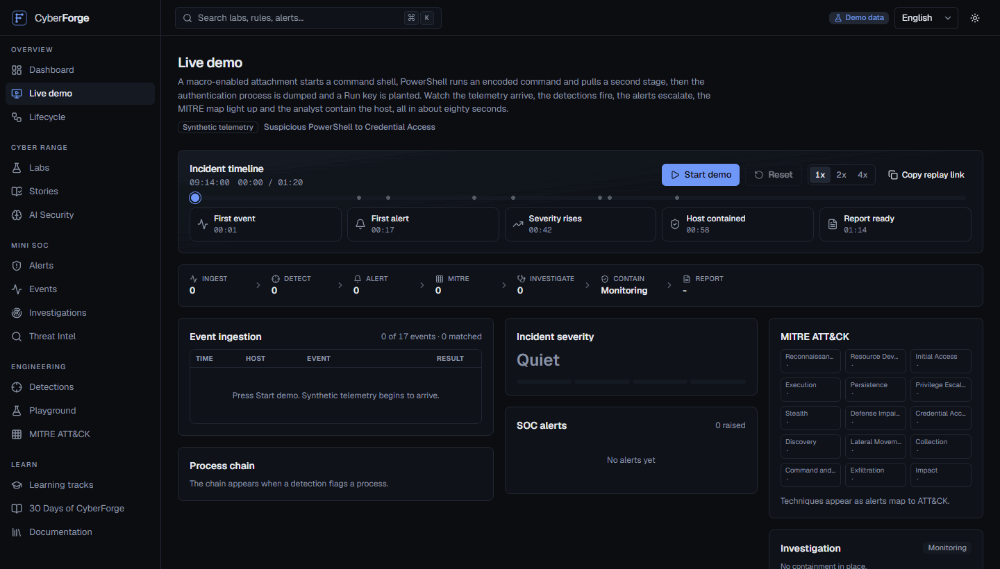

<p align="center">
  
</p>

<h1 align="center">CyberForge</h1>

<p align="center"><strong>An open-source lab for detection engineering and SOC investigations.</strong></p>

<p align="center">
  <a href="#quick-start">Quick start</a> ·
  <a href="#try-your-first-investigation">First investigation</a> ·
  <a href="#documentation">Documentation</a> ·
  <a href="CONTRIBUTING.md">Contribute</a>
</p>

[](https://github.com/rahmankutlu/cyberforge/actions/workflows/ci.yml)
[](https://github.com/rahmankutlu/cyberforge/actions/workflows/e2e.yml)
[](https://github.com/rahmankutlu/cyberforge/actions/workflows/security.yml)
[](https://github.com/rahmankutlu/cyberforge/releases/latest)
[](LICENSE)

Replay a synthetic incident, see exactly why a detection rule matched, and follow the resulting alert through investigation and containment. CyberForge runs locally and includes an English and Turkish interface.



The 80-second demo replays the same incident every time. [How the demo works](docs/demo-mode.md)

## Quick start

Install Git and Docker with Compose v2. The first run downloads images and dependencies. The seeded demo runs locally without an account or API key.

```bash
git clone https://github.com/rahmankutlu/cyberforge.git
cd cyberforge
docker compose --env-file .env.example up --build --wait
```

Once the services are ready, open the [incident demo](http://localhost:3000/demo), the [dashboard](http://localhost:3000), or the [API reference](http://localhost:8000/docs). See the [setup guide](docs/getting-started.md) for Windows PowerShell, a Docker-free setup with SQLite, and shutdown commands.

## Try your first investigation

1. **Watch a synthetic incident unfold.** Open [Live demo](http://localhost:3000/demo) and press **Start demo**. Follow the telemetry, alerts and MITRE ATT&CK techniques as the incident moves toward containment.
2. **Explain a match.** Open the [Detection playground](http://localhost:3000/detections/playground), select the **Suspicious PowerShell simulation** dataset, load **PowerShell Launched With Encoded Command**, and run the rule. Pick a matched event to inspect the exact fields and condition that fired.
3. **Make the analyst's call.** Pick a case in [Attack stories](http://localhost:3000/stories), review the evidence, and choose a containment action. Use the [Mini SOC](http://localhost:3000/soc/alerts) to practice triage, notes, case assignment and incident reporting.

<details>
<summary>Preview the detection playground</summary>

<picture>
  <source media="(prefers-color-scheme: light)" srcset="docs/assets/screenshots/detection-playground-light.png">
  
</picture>

</details>

## Detections as code

Each shipped Sigma rule has positive and negative test cases beside its YAML file. CI runs them, including multi-event and correlation cases, and generates the coverage figures below. The workbench also translates Sigma to Splunk, Elastic, Microsoft Sentinel and OpenSearch. YARA and Suricata use teaching evaluators. [Testing detections](docs/testing-detections.md) · [Evaluator scope and translations](docs/detections.md)

<!-- prettier-ignore-start -->
<!-- stats:start -->
<!-- Generated by `pnpm content:readme`. Do not edit by hand. -->

| | |
| --- | ---: |
| Labs | 20 |
| Sigma rules | 56 |
| YARA rules | 5 |
| Suricata rules | 5 |
| MITRE techniques mapped | 53 |
| Attack stories | 5 |
| Detection datasets | 11 |
| Live demos | 1 |
| Detection tests | 204 |
| Detection test coverage | 56/56 (100%) |

<!-- stats:end -->
<!-- prettier-ignore-end -->

Run `pnpm test:detections` after [setting up the development environment](docs/getting-started.md#option-2-from-source).

## Architecture

Next.js and TypeScript serve the web app, with FastAPI handling content validation, telemetry replay and rule evaluation. Docker Compose uses PostgreSQL and Redis. Source development can use SQLite and in-memory rate limiting. The rules, labs, scenarios and datasets are versioned alongside their tests. [Architecture overview](ARCHITECTURE.md) · [OpenAPI contract](docs/api/openapi.json)

The default demos replay synthetic telemetry. Optional training services have a separate Docker profile, and published ports bind to loopback. Optional AI-assisted alert analysis requires a provider you configure. [Security model](docs/security-model.md) · [Vulnerability reporting](SECURITY.md)

## Documentation

| I want to…                    | Start here                                                                                                                   |
| ----------------------------- | ---------------------------------------------------------------------------------------------------------------------------- |
| Run CyberForge locally        | [Getting started](docs/getting-started.md)                                                                                   |
| Explore exercises             | [Lab catalogue](docs/labs.md) · [Investigation stories](docs/stories.md) · [AI security](docs/ai-security.md)                |
| Understand technique coverage | [MITRE ATT&CK and ATLAS](docs/mitre.md)                                                                                      |
| Add or improve content        | [Contributing](CONTRIBUTING.md) · [Write a detection](docs/creating-a-detection.md) · [Create a lab](docs/creating-a-lab.md) |
| Follow changes or get help    | [Changelog](CHANGELOG.md) · [Roadmap](ROADMAP.md) · [Support](SUPPORT.md)                                                    |

Created and maintained by Abdurrahman Kutlu. [Website](https://rahmankutlu.com) · [GitHub profile](https://github.com/rahmankutlu) · [MIT License](LICENSE) · [Third-party notices](NOTICE.md)
