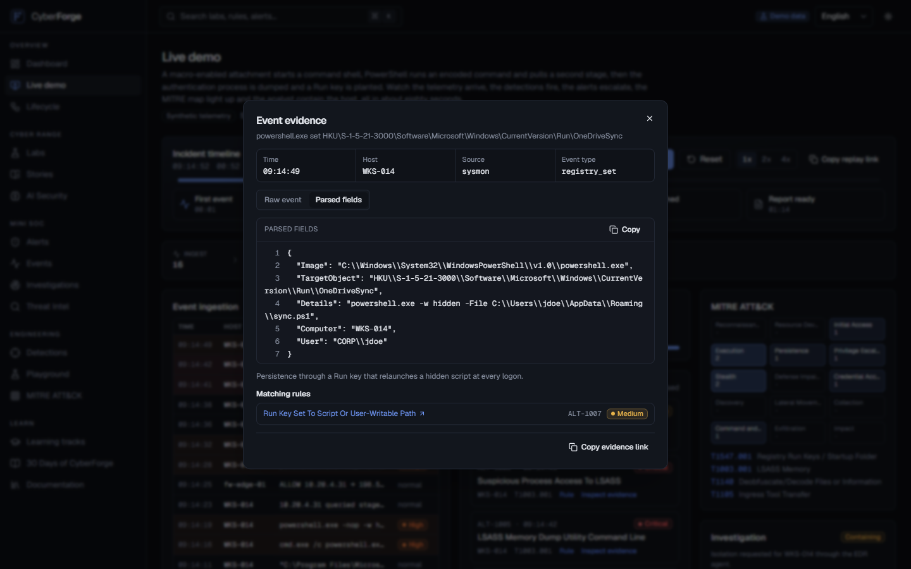

# Demo mode

`/demo` plays a complete incident in about eighty seconds, entirely in your browser. It exists for three audiences: someone deciding in fifteen seconds whether CyberForge is worth their time, someone giving a talk, and someone who wants a screenshot or a recording that stays current.

- No external service and no AI provider. Nothing leaves your machine.
- Deterministic. The same second of the demo looks identical every time.
- Everything on screen is derived from the telemetry, not written by hand.

## The default scenario

**Suspicious PowerShell to Credential Access.** A macro-enabled attachment starts a shell, PowerShell runs an encoded command and downloads a second stage, the authentication process is dumped and a Run key is planted. Then the analyst contains the host.

```text
Start demo
  → synthetic telemetry begins to arrive
  → detection rules trigger on real events
  → SOC alerts appear, incident severity escalates (high → critical)
  → the MITRE heatmap lights up as techniques are observed
  → the process chain and investigation notes fill in
  → containment state changes (monitoring → containing → contained)
  → an incident summary is written
```

Start, pause or reset the replay at 1×, 2× or 4× speed. Use the timeline slider or a milestone to jump to a moment and pause there. The slider supports arrow keys and Home/End.

Select an event in the telemetry table or **Inspect evidence** under a SOC alert to pause and examine the original event and its parsed fields. The inspector shows matching rules and the alerts they have raised by that point in the replay.

<picture>
  <source media="(prefers-color-scheme: light)" srcset="assets/screenshots/demo-evidence-light.png">
  
</picture>

## Linking to a moment

**Copy replay link** captures the current position and speed. **Copy evidence link** also opens the selected event. The same query parameters drive the README screenshots.

| Parameter  | Meaning                                          | Example                    |
| ---------- | ------------------------------------------------ | -------------------------- |
| `t`        | Start paused at this many seconds                | `/demo?t=52`               |
| `speed`    | Playback speed: `1`, `2` or `4`                  | `/demo?speed=4`            |
| `autoplay` | Start playing immediately when set to `1`        | `/demo?autoplay=1&speed=2` |
| `scenario` | A scenario slug, when more than one is installed | `/demo?scenario=my-demo`   |
| `event`    | Inspect a visible event at the specified time    | `/demo?t=52&event=evt-1`   |

## How it is built

A scenario is one file, `demos/<slug>.yaml`: telemetry on a timeline (seconds from the start), analyst notes and containment steps. Everything else is computed when the API loads it:

- **Detections and alerts.** The shipped Sigma rules run over the telemetry with the same engine as the SOC. An alert is raised one second after the event that triggered it.
- **Severity.** The incident's severity is the highest alert severity so far, so it can only escalate.
- **MITRE.** Each alert's rule maps to techniques; each technique lights up its tactics the moment it is first seen.
- **Process chain.** Parent and child processes from the telemetry, keeping only flagged processes and their ancestors.
- **Summary.** A template fills in counts, the sequence of alerts, the techniques observed and the time to first alert and to containment. It is not generated by a model.

`pnpm validate:content` checks every scenario: events must leave room for the summary, at least three alerts must fire, at least one technique must be observed, and all addresses must be synthetic.

To add a scenario, copy `demos/suspicious-powershell-to-credential-access.yaml`, change the events and check it with `python -m cyberforge validate`. The event fields use the same vocabulary as [lab scenarios](contributing-labs.md) and the [playground](detections.md#the-playground).

## Live event stream

The dashboard shows a live feed of synthetic events with the rule that matched, over plain Server-Sent Events:

```text
GET /api/v1/stream/events?rate=1.5&limit=400
event: telemetry
data: {"timestamp": "...", "source": "sysmon", "host": "WKS-021", "event_type": "process_creation",
       "rule": "PowerShell Launched With Encoded Command", "severity": "high", ...}
```

It replays a fixed pool of synthetic events (every dataset match plus a sample of ordinary traffic). The stream ends after `limit` events or ten minutes, at most 20 streams run at once, and the browser reconnects on its own. Pausing the dashboard panel closes the connection.

SSE was chosen over WebSockets because the data flows one way, it works through the same-origin proxy, and `EventSource` reconnects for free.

## Regenerating screenshots and the GIF

See [Demo assets](demo-assets.md).
